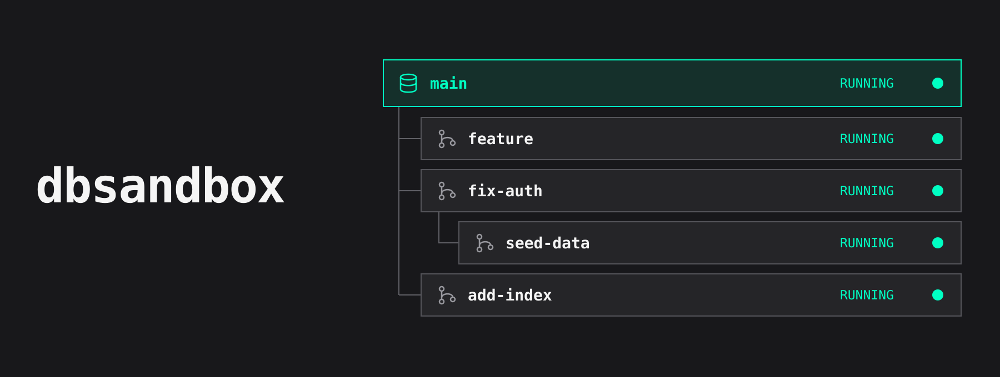
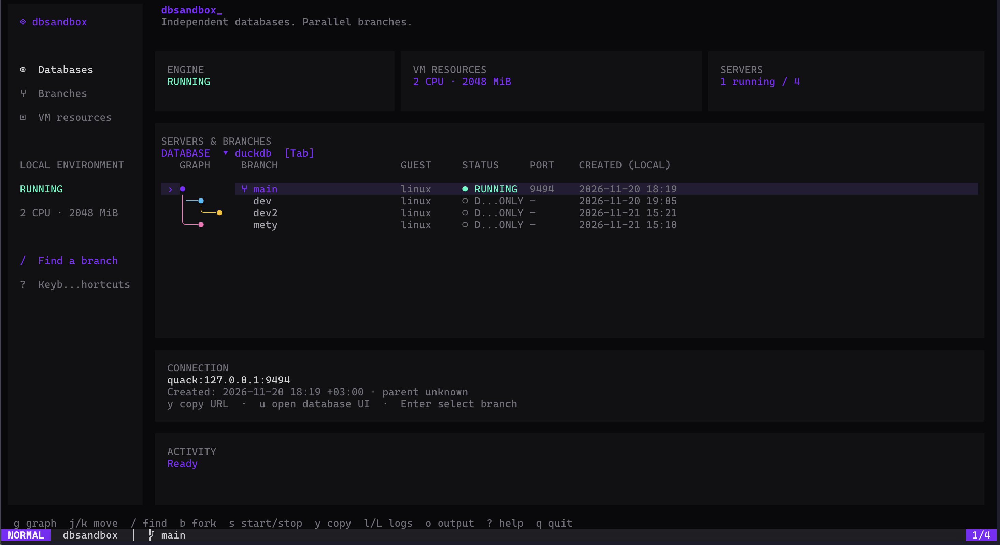

[](https://github.com/tsirysndr/dbsandbox/actions/workflows/test.yml)

Database, search and authorization sandboxes in one PureScript CLI, powered by
[bsdkrun](https://github.com/tsirysndr/bsdkrun). Fork database data with ZFS
copy-on-write and run the forks as independent servers at the same time.

```sh
dbsandbox postgres start                         # Start a PostgreSQL server
dbsandbox postgres branch feature                # Fork the data and start a parallel server
dbsandbox postgres --branch feature url          # Show the feature server connection URL
dbsandbox postgres checkout feature              # Select feature; other servers keep running

dbsandbox mariadb start                          # Start a MariaDB server
dbsandbox duckdb start linux 2.0.0               # Start DuckDB 2.0.0 with a Quack server
dbsandbox duckdb ui                             # Open the running branch in DuckDB's web UI
dbsandbox sqlite start                           # Start a libSQL HTTP server
dbsandbox mysql start --port 3307                # Start MySQL alongside MariaDB on another port
dbsandbox typesense start --password my-api-key  # Start Typesense with a custom API key
dbsandbox chroma start                           # Start a Chroma vector database server
```



## Installation

The host needs macOS Apple Silicon or Linux with KVM, [bsdkrun](https://github.com/tsirysndr/bsdkrun) **0.12.2 or newer**,
and the Docker CLI for Linux guests. Docker Desktop is unnecessary: [bsdkrun](https://github.com/tsirysndr/bsdkrun)
provides the engine VM. First startup needs network access for images/packages.

Install with Homebrew on macOS Apple Silicon or Linux:

```sh
brew install tsirysndr/tap/dbsandbox
dbsandbox --help
```

The formula installs the Docker CLI and bsdkrun dependencies.

Or install with Nix (Linux x86_64/ARM64 or macOS Apple Silicon):

```sh
nix profile install github:tsirysndr/dbsandbox
dbsandbox --help
```

The flake includes [bsdkrun](https://github.com/tsirysndr/bsdkrun) and the Docker CLI.
On macOS, install the libkrun fork below. Uninstall any previous libkrun formula first:

```sh
brew uninstall libkrun # If previously installed
brew install tsirysndr/tap/libkrun
BSDKRUN_IMPURE=1 nix profile install --impure github:tsirysndr/dbsandbox
```

For development, run `nix develop` from the checkout. It provides Bun, Node.js,
PureScript, Spago, formatting tools, and all JavaScript development dependencies.
On macOS, use `BSDKRUN_IMPURE=1 nix develop --impure` after installing libkrun.
Build with `nix build` (macOS: `BSDKRUN_IMPURE=1 nix build --impure`).

Or use npm (Node.js 18+):

```sh
npx @tsiry/dbsandbox --help
# Or install globally:
npm install -g @tsiry/dbsandbox
```

The npm package downloads the matching GitHub release, verifies `SHA256SUMS`,
and includes `@bsdkrun/cli` as a dependency. Its source is in [`npm/`](npm/).
The matching release assets and npm package must be published first.

From source, use Bun 1.4.5 or newer (Node.js 22/24 is also used by Spago's toolchain):

```sh
bun install --frozen-lockfile
bun link
dbsandbox --help
dbsandbox postgres doctor
```

To build one standalone executable:

```sh
bun run build:bin
./dist/dbsandbox --version
```

The core executable needs neither Node.js nor Bun at runtime. Optional host
tools such as Drizzle Studio/drizzle-kit, pgcli/mycli and pgroll keep their
respective host dependencies. Source installs include Drizzle's Node packages. Standalone Studio checks that
Drizzle can load the database driver and uses an isolated, pinned toolchain under
`~/.config/dbsandbox/tools` when needed (Bun installs it on first use). Global
packages are preserved. Python clients can use `uv` or `pipx`.

The GitHub release workflow builds macOS ARM64, Linux x86_64 and Linux ARM64
archives and `SHA256SUMS`. `install.sh` consumes a published release, checks its
checksum, and installs to `~/.local/bin`; set `DBSANDBOX_INSTALL_DIR` to change
that directory or pass a release tag. A release must be published before the
release installer can download it:

```sh
curl -fsSL https://raw.githubusercontent.com/tsirysndr/dbsandbox/main/install.sh | sh
# Pin a release:
curl -fsSL https://raw.githubusercontent.com/tsirysndr/dbsandbox/main/install.sh | sh -s -- v0.2.0
```

## Global commands

```sh
dbsandbox ps                     # List running servers across all databases
dbsandbox ps --all               # Include stopped servers and parallel branches
dbsandbox ps --all --json        # Machine-readable inventory with passwords redacted
dbsandbox databases              # List supported databases, versions, ports and guests
dbsandbox doctor                 # Check host tools, runtime version and virtualization
dbsandbox engine status          # Inspect the shared VM, memory, CPUs and image storage
dbsandbox stop --all             # Stop configured servers; retain their data and engine
dbsandbox ui                     # Open the local dashboard in your browser
dbsandbox tui                    # Open the native terminal dashboard
```

### Dashboards

Choose a database to explore its branch graph, manage servers, copy connection
URLs, and view or download logs. Use `/` to search and `?` for keyboard shortcuts.
Dates use local time. Open a database console, container shell, or VM terminal
from a branch row. Drag the terminal’s top edge to resize, or switch to fullscreen.

Adjust CPU and memory in the VM settings. Resizing the shared Linux VM restarts
its servers.

For a fixed port or a headless host:

```sh
dbsandbox ui --port 8888 --no-open
```

### Terminal dashboard

Run `dbsandbox tui` for the terminal dashboard. Set `DBSANDBOX_NERD_FONT=0`
if your font does not support Nerd Font icons.

| Key | Action |
| --- | --- |
| `Tab` | Choose the database shown in the branch list |
| `g` | Toggle branch graph / table |
| `[` / `]` | Pan graph lanes horizontally |
| `j` / `k`, arrows | Move between servers |
| `/`, `Ctrl-P` | Open fzf-style branch search; Enter jumps to a result |
| `Enter` | Select the highlighted branch |
| `b` | Fork a branch |
| `d` | Delete an inactive branch, with confirmation |
| `s` | Start or stop the selected server |
| `u` / `U` | Open or close its database UI |
| `y` | Copy its full connection URL |
| `c` / `t` / `v` | Open database console / container shell / VM terminal |
| `l` / `L` | View database logs / VM logs |
| `o` | View captured operation output |
| `n` | Start a database: `database [guest] [version] [CPU] [MiB]` |
| `e` | Override shared VM CPU and memory |
| `S` | Stop all configured servers, with confirmation |
| `r` | Refresh |
| `?` | Show keyboard shortcuts |
| `q` / `Ctrl-C` | Quit and close owned UI sessions |

In a terminal panel, Ctrl-F toggles fullscreen and Esc closes it.

In the log viewer, `/` filters, `f` toggles follow, `t` toggles timestamps,
and `d` exports logs as text.

Use `--no-color` or `NO_COLOR=1` to disable colors.

### Shell completion

Completion is available for Bash, Zsh and Fish. Configure it once for your shell:

```sh
# Bash: add to ~/.bashrc
source <(dbsandbox completion bash)

# Zsh: add to ~/.zshrc
autoload -Uz compinit && compinit
source <(dbsandbox completion zsh)

# Fish: generate the completion file
mkdir -p ~/.config/fish/completions
dbsandbox completion fish > ~/.config/fish/completions/dbsandbox.fish
```

Restart your shell or source its configuration after adding the Bash/Zsh lines.
Regenerate the Fish completion file after updating dbsandbox.

## Existing sandboxes

Saved configuration lives in `$XDG_CONFIG_HOME/dbsandbox/state.sqlite`
(default `~/.config/dbsandbox/state.sqlite`). Existing configuration is imported
automatically; database data stays in its ZFS volumes.

```sh
dbsandbox postgres status
dbsandbox duckdb url
```

The visible command is `dbsandbox DATABASE`; resource names reported by [bsdkrun](https://github.com/tsirysndr/bsdkrun)
can still contain the original tool names. `XDG_CONFIG_HOME` is respected.

## Supported databases

| Database | Command | Default Linux image | Default port | BSD mode |
| --- | --- | --- | --- | --- |
| PostgreSQL | `postgres` (`postgresql`, `pg`) | `postgres:18` | 5432 | Official server packages |
| MariaDB | `mariadb` | `mariadb:12` | 3306 | Official server packages |
| MySQL | `mysql` | `mysql:8.4` | 3306 | FreeBSD 8.4 / NetBSD 8.0 pkgsrc; binary availability varies |
| Typesense | `typesense` | `typesense/typesense:30.2` | 8108 | Linux only |
| Chroma | `chroma` | `chromadb/chroma:1.5.3` | 8000 | Linux only |
| DuckDB | `duckdb` | `duckdb/duckdb:2.0.0` | 9494, Quack | Embedded file access; DuckDB >= 2 required |
| Databend | `databend` | `datafuselabs/databend:latest` | 8000, HTTP SQL | Linux only |
| TigerBeetle | `tigerbeetle` | `ghcr.io/tigerbeetle/tigerbeetle:latest` | 3000 | Linux only |
| YugabyteDB | `yugabytedb` | `yugabytedb/yugabyte:2026.1.3.0-b100` | 5433, YSQL | Linux only |
| Vearch | `vearch` | `vearch/vearch:latest` | 9001 | Linux only |
| TimescaleDB | `timescale` | `timescale/timescaledb:latest-pg18` | 5432 | Linux only |
| TiDB | `tidb` | `pingcap/tidb:latest` | 4000, MySQL | Linux only |
| SpiceDB | `spicedb` | `authzed/spicedb:latest` + PostgreSQL 17 | 8443, HTTP gateway | Linux only |
| SurrealDB | `surrealdb` | `surrealdb/surrealdb:latest` | 8000 | Linux only |
| ScyllaDB | `scylladb` | `scylladb/scylla:latest` | 9042, CQL | Linux only |
| Qdrant | `qdrant` | `qdrant/qdrant:latest` | 6333, HTTP | Linux only |
| MongoDB | `mongodb` | `mongo:8` | 27017 | Linux only |
| Cassandra | `cassandra` | `cassandra:5` | 9042, CQL | Linux only |
| ClickHouse | `clickhouse` | `clickhouse/clickhouse-server:latest` | 8123, HTTP | Linux only |
| ArangoDB | `arangodb` | `arangodb:latest` | 8529 | Linux only |
| CockroachDB | `cockroachdb` | `cockroachdb/cockroach:latest` | 26257, PostgreSQL | Linux only |
| SQLite | `sqlite` (`libsql`) | `ghcr.io/tursodatabase/libsql-server:latest` | 8080 | Linux only |

Each database has its own state, branches and selection. All Linux containers
share the Docker engine VM. PostgreSQL, MariaDB and MySQL on FreeBSD/NetBSD use a
shared VM per database, with separate processes for parallel branches.

## Parallel branches

```sh
dbsandbox postgres branch feature
dbsandbox postgres branch experiment --from feature
dbsandbox postgres branch staging --port 15433
dbsandbox postgres branch

dbsandbox postgres --branch feature status
dbsandbox postgres --branch feature psql -c 'select current_database()'
dbsandbox postgres --branch feature stop
dbsandbox postgres --branch feature start

dbsandbox postgres checkout feature
dbsandbox postgres url
dbsandbox postgres checkout main
dbsandbox postgres branch -d experiment
```

`branch NAME` snapshots and clones the source dataset, starts a parallel
instance, and leaves your selection unchanged. It inherits the source's guest
OS, database version, database name and credentials. Nested forks use `--from`.
Writes remain isolated in each dataset; committed data is recovered from the
cloned WAL/redo logs as after a crash.

Ports are chosen automatically above the source's host port, skipping live
listeners and reservations held by stopped branches. BSD forks also check guest
ports. An explicit `--port` collision fails before creating a dataset. Ports
remain reserved until the branch is deleted. A busy port on restart is reported.

Put `--branch NAME` after the database name and **before the command** to target
an instance without changing your selection. `checkout NAME` selects an
existing parallel instance; other servers keep running. For branches without
an instance, checkout keeps the parent-server mount-switching behavior.
`checkout -b NAME` retains that behavior for other database profiles.

Linux DuckDB keeps every branch server running independently. Checking out an
existing data-only DuckDB branch starts it as a separate server with its own
port; `duckdb checkout -b NAME` creates and selects a new parallel server.
`dbsandbox duckdb --branch NAME start` starts an old data-only branch without
changing selection. Checking out `main` leaves all other branch servers running.

Linux runs one container per instance, bind-mounting only its own dataset.
BSD PostgreSQL/MariaDB/MySQL forks run separate processes with their own data paths,
ports, PID files, sockets and logs. Exactly one VM imports a ZFS pool; the same
disk is never imported into multiple VMs at once. BSD processes share a kernel
and are not a security boundary. DuckDB's BSD branches remain embedded file
access rather than network servers.

The active branch and `RUNNING` status use neon teal on terminals. `NO_COLOR`
and redirected output disable color.

## Commands and clients

Every database supports `start`, `stop`, `status`, `branch`, `checkout`, `url`,
`exec`, `ssh`, `log`, `doctor` and `destroy`. Use `--help` at any level.

```sh
dbsandbox postgres start freebsd --user app --password secret --db app
dbsandbox mariadb start netbsd --port 13306
dbsandbox duckdb start --password configurable-token
dbsandbox duckdb token
dbsandbox duckdb duckdb -noheader -csv -c 'select 42'
dbsandbox mariadb mariadb -N -e 'select 42'
dbsandbox sqlite sqlite3 'select 42'
```

PostgreSQL exposes `psql`, `pgcli`, Drizzle Studio/drizzle-kit, and the pgroll
`migrate`, `pgroll` and `setup` commands. MariaDB exposes `mariadb`/`mysql`,
`mycli`, and Studio/drizzle-kit. MySQL has its own `mysql` client, `mycli`,
and Studio/drizzle-kit. MySQL binary logging is disabled for local ZFS clones;
replication is not configured. On BSD, MySQL uses a separate server process per
branch and disables the X Plugin to avoid a second shared listening port.
SQLite exposes `sqlite3`/`tursodb`, `litecli`,
and Studio/drizzle-kit when running libSQL. DuckDB exposes `duckdb`/`sql`/`cli`
and Quack authentication tokens; Drizzle does not support that protocol.

SQLite also supports the in-process engines `turso` and `sqlite3`:

```sh
dbsandbox sqlite start linux turso
dbsandbox sqlite start linux sqlite3
```

Choose an engine/version on first creation; destroy that database's sandbox
before changing it. Serverless modes expose no port and disable Studio.
Database CLI arguments are forwarded without requiring a host database client.

`branch -d NAME` stops and deletes only the chosen fork. A failed fork startup
retains its data and configuration for `--branch NAME start` to retry.
`dbsandbox DATABASE destroy` removes that database's parent and all its forks,
with confirmation; `--yes` bypasses the prompt. It preserves other databases and
the shared Docker VM. An explicit `--branch NAME destroy` removes only that fork.

## Database web UIs

```sh
dbsandbox duckdb ui                              # Start DuckDB's UI and open your browser
dbsandbox duckdb --branch feature ui --port 4214  # Browse a specific parallel branch
dbsandbox duckdb ui --no-open                    # Print the URL without opening a browser
dbsandbox postgres studio                        # Start Drizzle Studio and open your browser
dbsandbox mysql studio --port 4984                # Use another Studio port
dbsandbox sqlite studio --no-open                 # Start Studio on a headless host
```

DuckDB's `ui` command requires a running Linux sandbox. It chooses a free host
port starting at 4213, or uses `--port`. The UI runs in a temporary container
and attaches the selected branch through Quack; it never opens the database
file as a second writer. The branch appears as the `sbx` catalog. Keep the
command running while using the UI; Ctrl-C removes its container and port
forward, leaving the database server running.
Stopping, deleting or recreating a database branch also closes its UI sessions.
If another client changes the schema, run `CALL quack_clear_cache();` in the UI
to refresh the attached catalog.

`studio` opens `https://local.drizzle.studio` after its local server is ready.
Custom ports and hosts are reflected in the URL; wildcard binds open through
loopback. Both commands
support `--no-open` and always print their URL. If automatic browser opening
is unavailable, open that URL manually.

## Typesense and Chroma APIs

Both services persist `/data` on their ZFS branch. `api` (also `http`) sends
requests to the selected server, prints the response, and exits nonzero on
HTTP errors. It needs no host curl or Python client.

```sh
dbsandbox typesense start --password my-api-key
dbsandbox typesense api POST /collections '{"name":"books","fields":[{"name":"title","type":"string"}]}'
dbsandbox typesense api GET /collections
dbsandbox typesense branch experiment
dbsandbox typesense --branch experiment api GET /collections
dbsandbox typesense token

dbsandbox chroma start
dbsandbox chroma api GET /api/v2/heartbeat
dbsandbox chroma api POST /api/v2/tenants/default_tenant/databases/default_database/collections '{"name":"documents"}'
dbsandbox chroma branch experiment
```

Typesense generates an API key when `--password` is omitted; the built-in
client supplies it as `X-TYPESENSE-API-KEY`. `token` prints the current branch's
key. Chroma uses its local, unauthenticated API. Both bind forwarded ports to
loopback. SQL clients, database/user flags and Drizzle commands are not exposed
for these API services. Typesense and Chroma currently use Linux guests
on both macOS and Linux hosts.

## Additional Linux backends

All services in the extended catalog use Linux guests. Aliases include
`timescaledb`, `mongo`, `cockroach`, `scylla` and `yugabyte`.

```sh
dbsandbox qdrant start --password my-api-key
dbsandbox qdrant api GET /collections
dbsandbox mongodb start --password local-secret
dbsandbox mongodb mongosh --eval 'db.runCommand({ping:1})'
dbsandbox cassandra cqlsh -e 'SELECT release_version FROM system.local'
dbsandbox clickhouse api POST / 'SELECT 42'
dbsandbox surrealdb api POST /sql 'INFO FOR ROOT;'
dbsandbox timescale start --port 15432
dbsandbox cockroachdb start
dbsandbox tidb start
dbsandbox tigerbeetle start
dbsandbox tigerbeetle repl
dbsandbox tigerbeetle repl --command="lookup_accounts id=1;"
dbsandbox spicedb start --password my-preshared-key
```

`branch NAME` and `--branch NAME` work across the catalog. When parent ports
conflict, select an unused port with `start --port PORT`; fork ports are chosen
automatically. Only each service's primary client endpoint is published.
SpiceDB exposes the authenticated HTTP gateway; its PostgreSQL datastore and
gRPC listener stay inside the container. TigerBeetle uses a single development
replica with cluster ID 0. TiDB uses persistent UniStore, and YugabyteDB and
CockroachDB use single-node configurations. These are local development setups.

MongoDB, ClickHouse, Databend and SurrealDB accept `--user`/`--password`.
ArangoDB uses the root user with `--password`. Qdrant and SpiceDB generate a
key by default, configurable with `--password` and readable with `token`.
Cassandra, ScyllaDB, Vearch, TiDB, YugabyteDB and CockroachDB use unauthenticated
local development modes; CockroachDB starts with `--insecure`.

SpiceDB's PostgreSQL, Databend's metadata and filesystem storage, and Vearch's
master/router/partition data are kept together on the ZFS branch. TigerBeetle
formats its data file only on first creation. Cassandra and ScyllaDB use
synchronous batch commit logs so acknowledged writes reach a fork immediately.
Image wrappers are generated from PureScript. Images must provide a build for the Linux guest's CPU
architecture; available architectures depend on the upstream tag.

Databend, TigerBeetle, ClickHouse, Cassandra, ScyllaDB and YugabyteDB request
6 GiB when creating a new engine, and grow smaller existing engines after a clean stop.
Other configured resources are preserved; the engine is never shrunk. ScyllaDB
limits networking IOCBs to 1024 per server so parallel branches share the VM's
async I/O capacity. For parallel branches of heavier servers, resize the shared
VM as needed:

```sh
bsdkrun docker stop
bsdkrun update bsdkrun-docker --cpus 4 --mem 6144
bsdkrun docker start --publish-bind 127.0.0.1
```

Pinecone is excluded: its local emulator was discontinued upstream.

## Development and CI

PureScript modules are grouped under `src/Sbx/Database`, `Runtime`, `Branch`,
`State`, `Management`, `Cli` and `UI` (with separate `Web` and `Terminal`
subfolders). Reusable bindings live in `packages/drizzle` and
`packages/opentui`. The Svelte/Tailwind/Lucide frontend lives in `ui/src`.

```sh
bun run format                   # purs-tidy and Prettier
bun run format:check             # Check PureScript and frontend formatting
```

```sh
bun run test                         # PureScript suites + Bun CLI, HTTP and CI tests
bun run build:bin
bun run test:e2e                  # all catalog live Linux suites, sequentially
bun bin/ci.js e2e duckdb         # one live profile
SBX_E2E_OS=freebsd bun bin/ci.js e2e postgres
SBX_E2E_OS=netbsd bun bin/ci.js e2e mariadb
SBX_E2E_OS=freebsd bun bin/ci.js e2e mysql
SBX_E2E_OS=netbsd bun bin/ci.js e2e mysql

fluentci run test unit
fluentci run --workflow test      # Ubuntu x86_64, sudo and /dev/kvm
```

The custom `.fluentci/test` PureScript component installs checksum-verified
[bsdkrun](https://github.com/tsirysndr/bsdkrun), runs unit tests, builds the executable, and tests real servers,
forwarded ports, credentials, nested forks, selection, persistence and cleanup.
Live tests use unique runtime names and temporary configuration. They preserve
existing services and remove their own containers/VMs and volumes in finalizers.
Missing virtualization is an error rather than a skipped test.

GitHub Actions uses `setup-fluentci@next` with pinned FluentCI 0.17.8 and the
locked `setup-purescript@v0.2.0` module. CI decisions, release validation and
cleanup live in `src/Ci` as PureScript; JavaScript supplies host/driver I/O.
Logs stream with progress heartbeats. Diagnostics go to
`.fluentci/test-logs/DATABASE/OS/` and are uploaded even after failure.

GitHub tests run one database per matrix job, including its unit tests and
protocol-specific persistence/branch suite. Set `DBSANDBOX_E2E_DATABASE` to
select a single service when running `bun run test:e2e` locally.

A `v*` tag matching `package.json` tests the project, builds three target
archives, verifies executable architecture, and publishes them with checksums
using the workflow's GitHub token. No extra repository secret is required.

### Cluster management

The Rust/Neon cluster module exposes one Axum API for databases and branches across dbsandbox instances, using configurable Consul or etcd state. The same `dbsandbox` executable supports `cluster serve` and `cluster join`. See the [cluster module guide](packages/cluster/README.md) for setup, API routes, and current storage limits.

See the [horizontal branch architecture and diagrams](docs/cluster-architecture.md) for per-branch placement and cross-node snapshot transfer.

Debian runtime and tool images use Trixie. Package installation runs in a temporary
RAM-backed root during image builds, then copies the finished filesystem into a
fresh layer. This avoids dpkg stale-handle failures on legacy virtio-fs Docker
stores while preserving the running database containers. Runtime image tags
include the Dockerfile hash so updated base images are selected for new builds.
