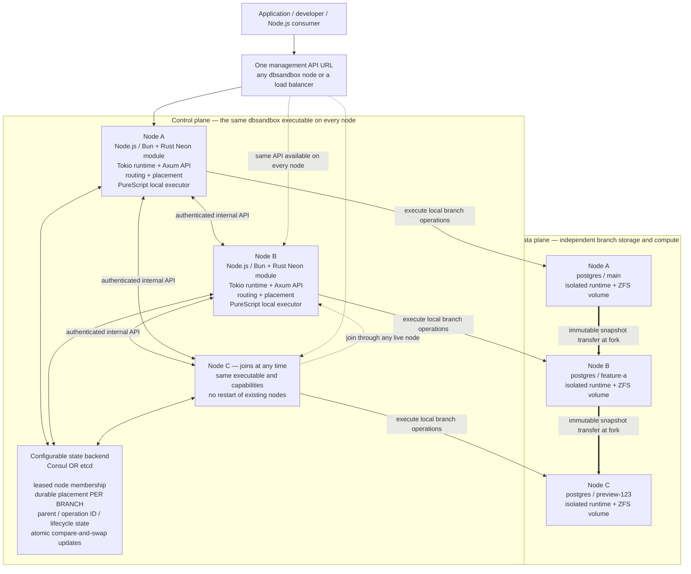
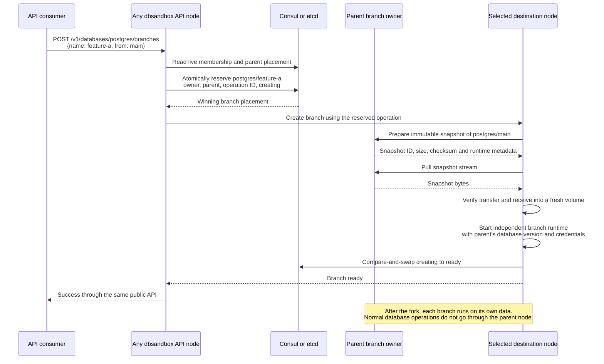

# Horizontally scalable database branches

One `dbsandbox` executable runs on every node. `cluster serve` starts a node;
`cluster join --server URL` starts the same node implementation and discovers an
existing cluster through any live node. Nodes can join while databases and
branches are running. Applications use one management API URL; that entry node
routes each request to the branch's owner.

Branch ownership is tracked individually. Snapshot transfer gives a destination
node independent storage, so adding nodes increases aggregate branch capacity.

## Create a branch

## Ownership and scaling

The scheduling unit is `(database, branch)`, not the database as a whole. For
example, `postgres/main`, `postgres/feature-a`, and `postgres/preview-123` can
belong to three different nodes. A child can itself be the source of another
branch. Each branch gets its own resource identity, runtime and writable volume.
The parent relationship records ancestry; it does not force colocation.

Membership is discovered from the configured backend on each placement decision.
New nodes become candidates for new branches immediately. The scheduler prefers
nodes with fewer assigned branches and can place children away from their source
when capacity is available. Existing branches keep their owners when membership
changes. A seed node is used for joining and has no permanent leadership role.

Every API node reads the same placement records and uses atomic writes to resolve
concurrent creation. The node that executes a mutation verifies membership,
ownership and the operation identity. Requests forwarded internally are executed
locally rather than forwarded again.

## State and failure behavior

Consul uses sessions for ephemeral membership and KV compare-and-swap for durable
branch records. Etcd uses leases for ephemeral membership and transactions for
durable branch records. Both retain placement independently of node liveness.
Separate tokens authorize remote API management (`DBSANDBOX_API_TOKEN`) and
node membership/internal traffic (`DBSANDBOX_CLUSTER_TOKEN`). `serve` generates
and prints missing tokens; environment variables override config-file values.

Branch lifecycle states distinguish `creating`, `ready`, `failed`, and `deleting`.
Local runtime metadata and database contents remain on the owning node; the state
backend does not hold database files or credentials.

A node that loses membership stops accepting management work and cancels in-flight
commands. An offline owner's branch stays unavailable until its storage is
recovered; a new empty database must never silently replace it. Failed snapshot
transfer must not publish a ready branch. Transfer files and snapshots require
bounded lifetimes and cleanup.

Cross-node forks transfer an immutable snapshot into independent destination
storage. They require time and network bandwidth proportional to the transferred
data. This design scales the number of independent branches and their aggregate
compute/storage across nodes. It does not shard an individual branch, replicate
writes, or provide automatic storage failover. Database protocol traffic is a
separate data-plane concern from the unified management API.

## Repository components

| Component | Responsibility |
| --- | --- |
| `crates/cluster` | Tokio/Axum coordinator, membership, branch placement, internal routing, snapshot orchestration |
| `crates/cluster-neon` | Node.js bindings and asynchronous lifecycle promises |
| `packages/cluster` | Node.js API and TypeScript declarations |
| `bin/dbsandbox.js` | Single executable entry point |
| `src/Sbx/Cluster` | PureScript CLI, token configuration, isolated runtimes and ZFS snapshot commands; minimal JS I/O FFI |
| Consul or etcd | Shared membership and branch lifecycle metadata |

The GitHub setup action installs Rust using FluentCI's pinned `setup-rust` module.
The native module is built with `cargo build --release --locked` before Bun
compiles the single executable. Each release platform builds on a matching native
runner so the embedded addon has the correct OS and architecture.
