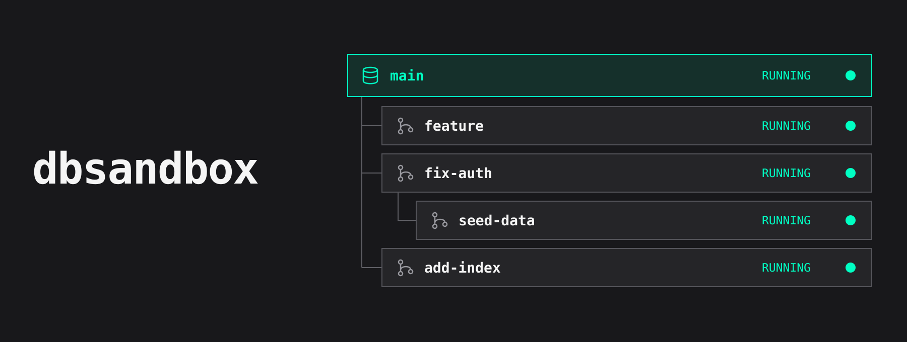
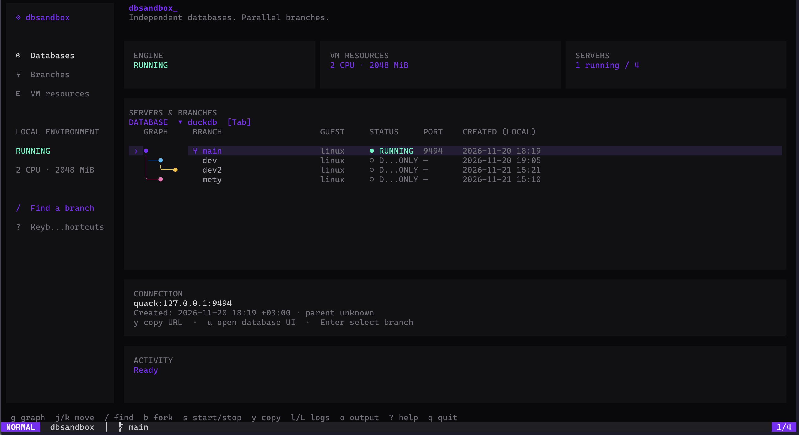

Database sandboxes with parallel ZFS branches, a web dashboard, and a native TUI.



## Installation

```sh
npx @tsiry/dbsandbox --help
npx @tsiry/dbsandbox postgres start
npx @tsiry/dbsandbox ui
npx @tsiry/dbsandbox tui
```

Or install globally:

```sh
npm install -g @tsiry/dbsandbox
dbsandbox --help
```

This small Node.js launcher downloads the native binary from the matching
[GitHub release](https://github.com/tsirysndr/dbsandbox/releases) and verifies its
`SHA256SUMS` checksum. It depends on `@bsdkrun/cli` and locates that dependency
automatically. If install scripts are disabled, the first invocation performs the
download. The database CLI itself runs as a standalone executable.

Supports macOS Apple Silicon, Linux x86_64, and Linux ARM64. Requires Node.js 18+
and `tar` to install. Running Linux guests also requires the Docker CLI and host
virtualization support. Follow [bsdkrun's host prerequisites](https://github.com/tsirysndr/bsdkrun#readme)
for libkrun, networking, and KVM access.

## Configuration

- `DBSANDBOX_DOWNLOAD_BASE`: release download directory for mirrors/testing.
- `DBSANDBOX_BINARY`: copy an existing local executable during installation.
- `DBSANDBOX_SKIP_DOWNLOAD=1`: skip downloading; unset before first use unless a binary is already installed.
- `BSDKRUN_BIN`: override the bundled bsdkrun launcher.

The package version must match a published GitHub release and its platform assets.
Publish the required `@bsdkrun/cli` version before publishing this package.
To publish from this repository after the release is available:

```sh
cd npm
npm publish --access public
```

Full documentation: [tsirysndr/dbsandbox](https://github.com/tsirysndr/dbsandbox).
